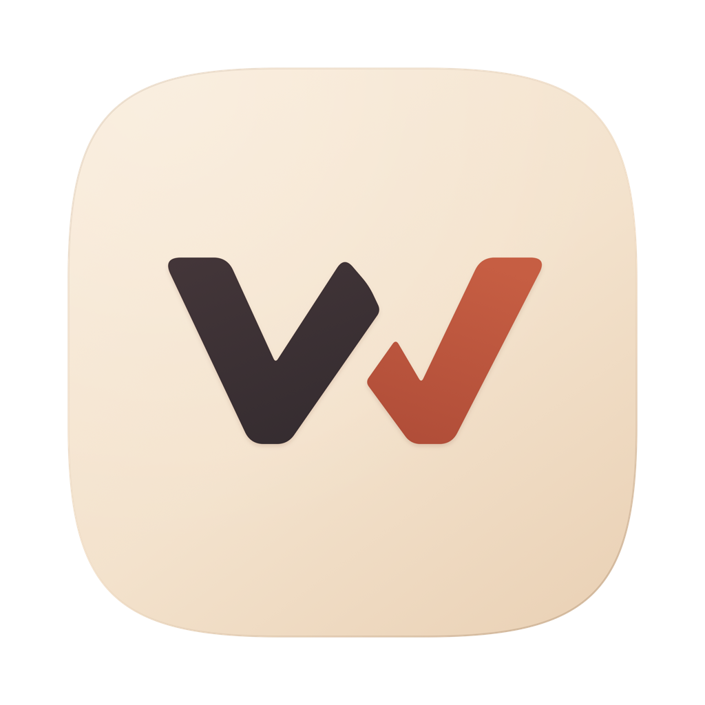

# MyGo Work

MyGo Work 是一个面向本地文件和项目的 Agent 工作台。桌面界面使用 MyGo，Go 宿主负责管理本地工作区、引擎进程和模型交互。界面参考 [OpenWork MIT 桌面版](https://github.com/different-ai/openwork/tree/v0.18.68)。

[下载已发布版本](https://github.com/zhimoe/mygo-work/releases/latest) · [多 Agent 运行时设计](docs/agents.md)

## 安装

以下说明适用于仓库当前源码构建的 v0.2.0。已发布版本的可用平台以 GitHub Releases 附件为准。[从源码构建](#从源码构建)

Windows 安装版与便携版的完整步骤见 [Windows 安装指南](docs/windows-install.md)。

| 平台 | 安装方式 |
| --- | --- |
| macOS Apple Silicon | 打开 DMG，把 **MyGoWork.app** 拖进「应用程序」 |
| Windows 11 ARM64 | 运行 `mygo-work-setup-0.2.0-arm64.exe`，系统需安装 [Microsoft Edge WebView2 Runtime](https://developer.microsoft.com/microsoft-edge/webview2/) |

安装包内置 **OpenCode 2.3.2**。macOS 包使用 ad hoc 签名，尚未经过 Apple 公证。Windows 安装包采用未签名构建。也可以在本机从源码构建。

## 开始使用

1. 点击「添加工作区」，选择一个本地文件夹。
2. 在左侧工作区下点击「新建任务」，选择模型，输入需求并点击「运行任务」。使用 OpenCode 时，也可以在「设置 → 模型供应商」添加 API 密钥。
3. 在侧栏查找任务历史，在右侧查看文件、文件差异、技能和 MCP 连接。

点击右下角齿轮打开设置，点击弹窗外即可关闭。应用默认显示简体中文，可以在「设置 → 界面语言」切换到 English，选择会在下次启动时保留。

### 使用 Pi Coding Agent

1. 安装 [Pi Coding Agent](https://docs.pi.dev/latest/quickstart)，在终端运行 `pi` 后使用 `/login` 或配置本地模型。当前版本以 Pi 1.5.2 验证。
2. 打开工作区，点击右下角「文档」旁的引擎名称，在按钮上方展开的列表中选择 **Pi Coding Agent** 或 **OpenCode v2**。也可以从工作区名称旁的「更多 → 任务引擎」切换。
3. 每个工作区独立保存所选引擎。切回原引擎可以继续原有会话，右下角的「文档」会打开当前引擎的官方文档。

Pi 不可用时，选择器会禁用 Pi 选项，仍可切回 OpenCode。安装后可重新打开选择器检查，若安装器更新了系统 PATH，则重新启动应用。Windows 上默认从 PATH 查找 `pi`，node 由 `pi.cmd` 自己查找，应用不再单独检查 node。如果 Pi 放在自定义路径，可以用 `MYGO_WORK_PI` 指向 `pi.exe` 或 `pi.cmd`，此时不要求 PATH 中有 `pi`。

Pi 使用本机 Pi 的模型、凭据、技能、MCP 和权限配置。Pi 会话支持流式回复、工具步骤、模型选择、停止、归档、恢复和常见 RPC 扩展表单。附件以本地路径交给 Pi。桌面的 OpenCode 连接管理、差异面板和工具授权适用于 OpenCode 工作区。

## 功能

| 功能 | 可用操作 |
| --- | --- |
| 工作区与会话 | 添加文件夹，新建、搜索、重命名、归档、恢复和删除会话 |
| 任务与模型 | 选择模型、推理强度与智能体，附加文件，查看流式回复和工具步骤，停止任务 |
| 交互 | 回答引擎发来的问题，审批 OpenCode 工具调用 |
| 文件 | 查看工作区文件、Markdown、CSV 和 TSV，编辑文本与表格，在文件管理器中定位文件 |
| OpenCode 连接 | 管理远程 MCP，浏览并附加技能，连接支持 API 密钥的模型供应商 |

对话里的行内代码和代码块按 `SF Mono`、`MonoLisa`、`Consolas`、`ui-monospace`、`monospace` 的顺序选用可用字体。

| 操作 | macOS | Windows |
| --- | --- | --- |
| 新建任务 | ⌘N | Ctrl+N |
| 搜索会话 | ⇧⌘F | Ctrl+Shift+F |
| 打开设置 | ⌘, | Ctrl+, |
| 输入框换行 | ⇧Enter | Shift+Enter |

## 从源码构建

需要 Git 和 Go 1.27.3 或更新版本。macOS 源码启动与打包：

```sh
git clone https://github.com/zhimoe/mygo-work.git
cd mygo-work
./scripts/install-opencode.sh
go run .
./scripts/build-macos.sh
```

在 macOS 上交叉构建 Windows 安装器：

```sh
# Windows 安装器需要 NSIS 的 makensis 命令，例如 brew install makensis
./scripts/build-windows-arm64.sh
./scripts/build-windows-amd64.sh
```

输出分别位于 `dist/darwin-arm64/`、`dist/windows-arm64/` 和 `dist/windows-amd64/`。macOS 使用 `-skip-dmg` 可仅构建应用，Windows 使用 `-skip-installer` 可仅构建便携目录。Windows 便携运行时需保留 `MyGoWork.exe` 与同目录的 `opencode.exe`。构建时脚本下载固定版本的 OpenCode，校验包完整性后再打包。

桌面应用图标、欢迎页和页面图标共用 `web/icons/mygo-work.png`，打包路径在 `mygo.json` 的 `icon` 中配置。

## 本地数据

| 路径或变量 | 用途 |
| --- | --- |
| macOS 的 `~/Library/Application Support/MyGo Work` | 默认应用数据目录 |
| Windows 的 `%APPDATA%\MyGo Work` | 默认应用数据目录 |
| `MYGO_WORK_DATA_DIR` | 指定独立的应用数据目录 |
| `MYGO_WORK_OPENCODE` | 指定已有的 OpenCode v2 可执行文件 |
| `MYGO_WORK_PI` | 指定本机 Pi CLI |
| `XDG_CONFIG_HOME` | 为 OpenCode 指定单独的全局配置根目录 |

工作区、语言、连接和会话记录保存在应用数据目录内。OpenCode 读取上游支持的全局和项目配置，引擎只监听回环地址，并使用每次启动生成的密码。模型请求由所选引擎发往所配置的供应商。

## 测试

```sh
go test ./...
go vet ./...
MYGO_WORK_TEST_OPENCODE="$(./scripts/install-opencode.sh)" \
MYGO_WORK_TEST_PI="$(command -v pi)" \
  go test -v -run 'Test(Pi)?Desktop' .
```

原生桌面集成测试在 MyGo WebView 中运行，通过真实 OpenCode 与 Pi 子进程调用本地测试模型。用例覆盖 Pi 检测、引擎切换、Pi 不可用时切回 OpenCode、中英文、点击弹窗外关闭设置、工具调用、权限、流式输出、停止、文件编辑及重启恢复。在 Windows ARM64 可用 `GOOS=windows GOARCH=arm64 go test -c` 交叉编译测试程序，再在安装了 WebView2 的客体内指定两个 CLI 路径并运行。

第三方许可见 [licenses](licenses/)。
